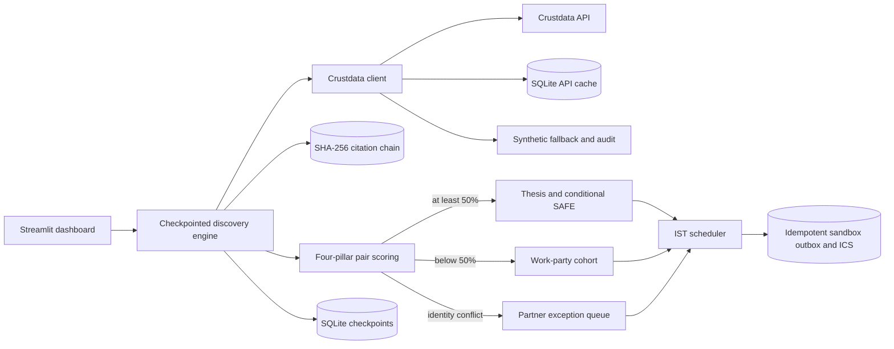

# Foundry-Zero: Autonomous Pre-Day-0 Venture Studio & Co-Founder Matchmaker

Foundry-Zero replaces parts of three services: pre-seed venture scouting, co-founder matchmaking, and event/calendar operations. It resolves company aliases, examines indexed hiring and funding signals, scores founder pairs across four evidence-linked pillars, and routes stronger matches to a 1-on-1 thesis and lower-scoring matches to a work-party. Invites and reminders stay in a local sandbox; the SAFE is a conditional discussion draft, not an investment commitment.

## Run locally and on Streamlit Cloud

Install `pip install -r requirements.txt` and run `streamlit run app.py`. The first start hydrates a small bundled **synthetic** flagship snapshot, including both pathways, an exception and citations. All example people and job postings are fictional. The snapshot is a demonstration, not cached live Crustdata. Cloud local SQLite is ephemeral; production deployment needs durable storage, a trusted externally retained ledger head, access controls, and a real notification integration.

Select Live Crustdata and configure `CRUSTDATA_API_KEY` in Streamlit secrets or the environment. Live requests use the SQLite cache. On missing credentials, HTTP errors or network failure, a logged synthetic fallback supplies an explicitly unverified company placeholder; a synthetic standing bench keeps the demonstration usable. It is not evidence of live hiring or verified employment. Synthetic benchmark candidates can appear alongside live candidates; check citation endpoints and hashes before interpreting a match. Empty fields score zero; an `Ex-` headline is a transition signal, not verification of departure. No named person's affiliation or identity is independently verified by this project.

On cold-start restoration, expired fixture meetings are moved into future IST business hours and their calendar notifications are updated. Restored work-parties start on Saturday. Meetings use IST business hours, with local conflict checks. Rescheduling accepts a weekday and a 12-hour time, such as `Sunday 4:00 PM IST`; it is not a general natural-language agent. Reminders require the UI action or an external caller to run `send_reminders`; they are not automatically scheduled by a daemon. RSVP links and calendar notifications are sandbox payloads only. API cache entries do not expire; delete cache rows to refresh them.

## Note on evolution

The team's account of the exploration: at 12:30 AM, a `/person/search` result for Razorpay `#897127` had an `Ex-Razorpay` headline while the current-employment filter still matched the company. That observation motivated the pivot from FDE-Zero toward a founder discovery workflow. This repository does not bundle that live record, so the example cannot be independently verified from the fixtures here.

## Engineering approaches evaluated

| Approach | Benefit | Limitation |
|---|---|---|
| Pure ReAct chat agent | Flexible exploration | Harder to replay, audit, and prevent duplicate actions |
| One-size-fits-all forced matching | Simple routing | Forces weak matches into 1-on-1 meetings |
| Checkpointed two-pathway engine | Replayable stages, citations, and deterministic >=50% thesis vs. <50% mixer routing | Heuristics are not proof of founder chemistry and need human validation |

## Hardest case

A former-employer headline can disagree with a current-employment match: preserve both signals and do not claim either is independently verified. Crustdata's filter path may use `company_id` while returned experience can use `crustdata_company_id`; the matcher accepts both. Alias resolution stores inputs against a canonical company ID, so `Razorpay` and `razorpay.com` do not create duplicate company rows. Unverified identity cases enter the partner queue before invitations.

## Architecture

The Mermaid source below renders directly on GitHub and can be copied into the submission's diagram tool.

The ledger detects edits relative to a trusted head. Someone controlling the database can rewrite the entire chain; retain the displayed head externally. Estimates count cache and checkpoint reuse, not monetary savings or guaranteed credits.

## Left out for the eight-hour build / next steps

Verify `/person/enrich` and live API schemas with real fixtures; establish real candidate consent and independently verify identity; use robust cross-company entity resolution and better career/tenure evidence; replace the synthetic standing bench with sourced records; obtain validated customer interviews, terms, and legal review; add durable hosted storage, authenticated partner approval, automated reminder workers, actual availability negotiation, external calendar integration, observability, and rate-limit controls. Scoring and curated stations are prototypes, not investment decisions or claims of market demand.

Run `python -m py_compile app.py service_engine.py scheduler_service.py crustdata_client.py db.py` and `python -m unittest discover -v` for the local checks.

## Development

Install development tools with `pip install -r requirements-dev.txt`. Run `python -m ruff check .`, `python -m ruff format --check .`, and `python -m unittest discover -v`. The tests use isolated temporary databases and cover fallback, cache corruption, collision negotiation, reminders, recovery, ledger tampering, and Streamlit interactions.

- `matching.py`: profile normalization and the four-pillar deterministic score.
- `service_engine.py`: company discovery, market evidence, candidate discovery, and routing; each stage has an independent checkpoint.
- `scheduler_service.py`: business-hour slot selection, calendar payloads, rescheduling and sandbox notifications. Conflicts are scoped to a run so separate demo sessions do not block each other.
- `crustdata_client.py`: secrets, response validation, cache, and labeled fallback.
- `db.py`: database schema, transactions, citations and snapshot hydration.
- `bootstrap.py`: startup restoration and expired fixture meeting refresh.
- `app.py`: the five-tab Streamlit interface.

Rebuild the bundled synthetic snapshot after fixture or generation changes with `python scripts/build_demo_seed.py`. This uses a separate temporary database and checks the resulting citation ledger before writing the bundle. Runtime data and secrets are excluded from Git.
